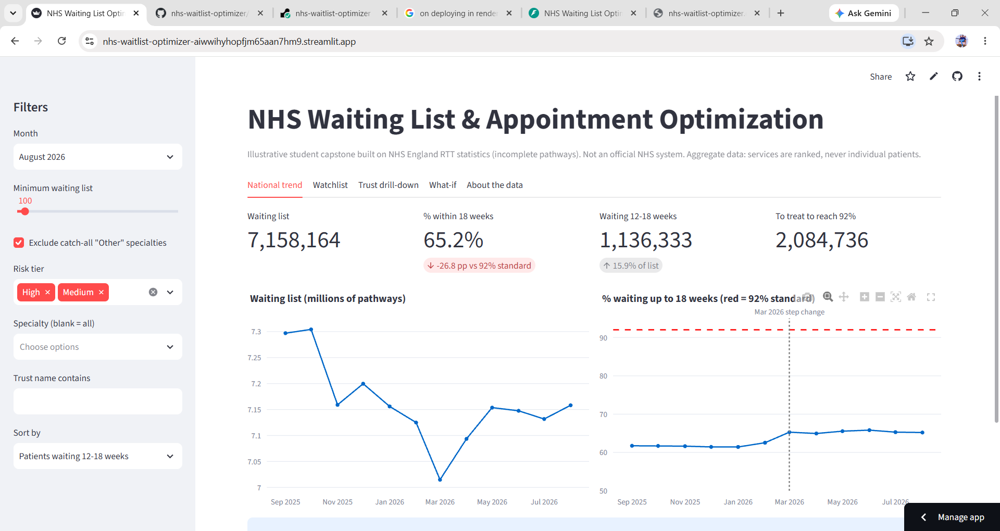
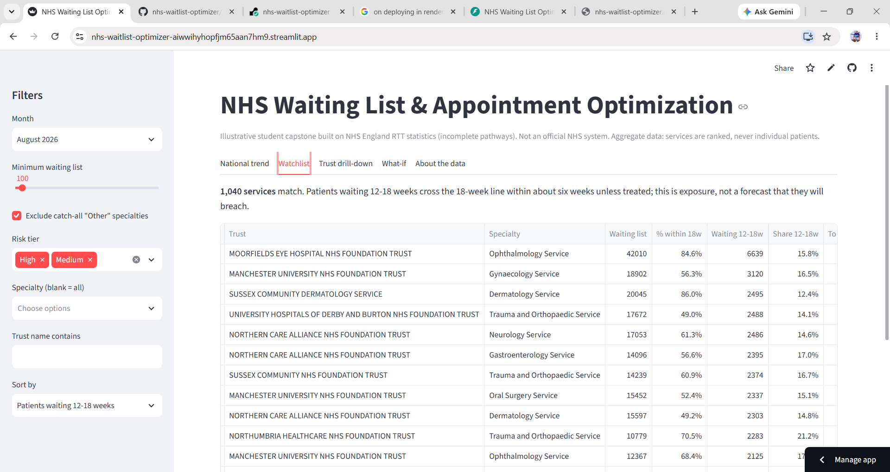
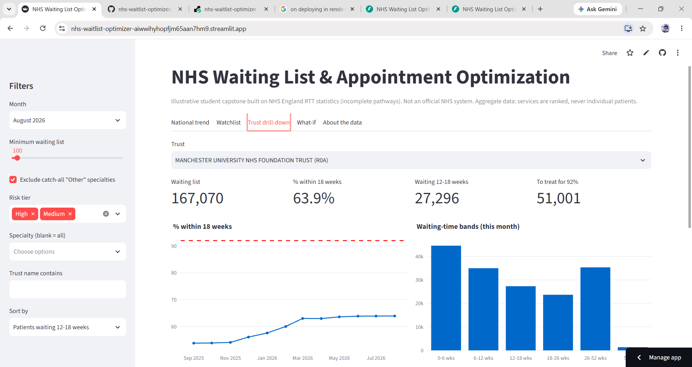
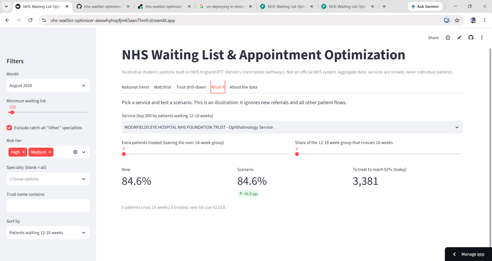
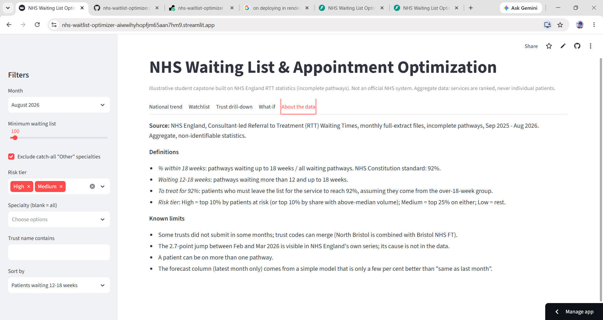
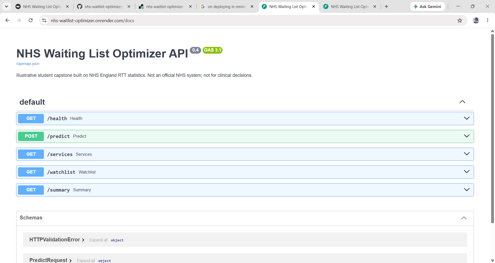
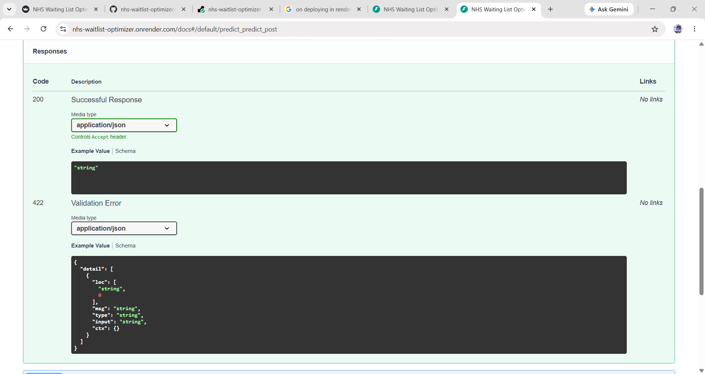
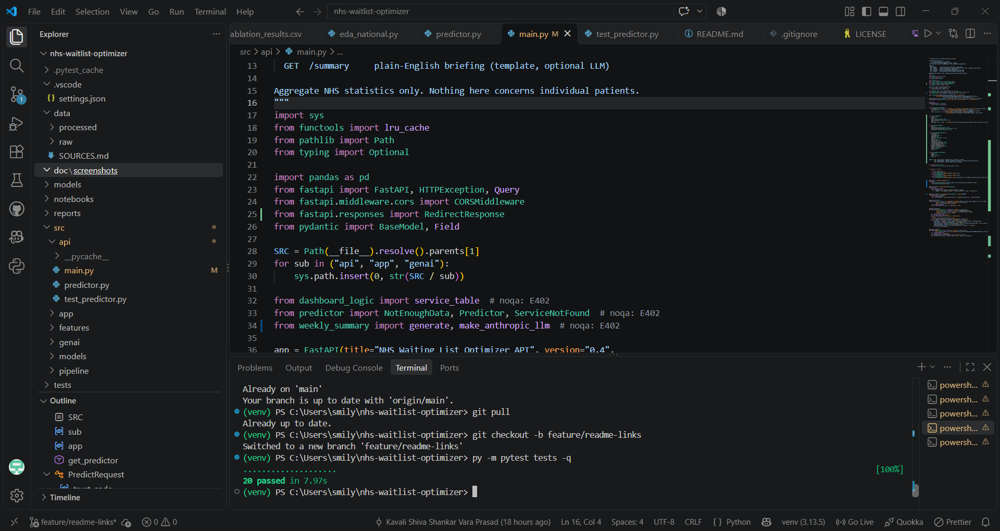
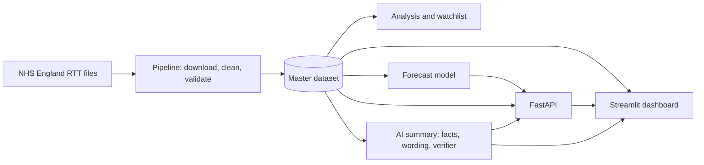

# nhs-waitlist-optimizer
# NHS Waiting List & Appointment Optimization (student capstone)

> **Illustrative portfolio project, not an official NHS system.** It uses only aggregate, non-identifiable
> NHS England open statistics and must not be used to make decisions about individual patients.

An end-to-end platform that analyses NHS England Referral to Treatment (RTT) waiting-list data, ranks services
by how many patients are close to breaching the 18-week standard, forecasts next month's performance, and
writes a plain-English briefing with guardrails.

**Live demo:** https://nhs-waitlist-optimizer-aiwwihyhopfjm65aan7hm9.streamlit.app
**API docs:** https://nhs-waitlist-optimizer.onrender.com/docs

## Screenshots

### Dashboard






### API



### Tests


## What it does

| Part | What you get |
|---|---|
| Data pipeline | Downloads 12 monthly RTT files, cleans them, merges a trust merger, and reconciles March 2026 to NHS England's published total within 44 pathways |
| Analysis | National trend, the March 2026 step change (62.5% to 65.3% within 18 weeks), trust and specialty variation |
| Breach-risk watchlist | Ranks trust and specialty services by patients waiting 12-18 weeks (about 1.13 million in August 2026) |
| Forecast model | Gradient boosting predicts next month's % within 18 weeks: error 2.17 points against 2.28 for "same as last month" (about 5% better) |
| Dashboard | Streamlit app: national trend, watchlist, trust drill-down, what-if scenarios, AI summary |
| API | FastAPI: `/predict` (with top drivers), `/services`, `/watchlist`, `/summary`, `/health` |
| AI summary | Python computes every number; an optional LLM only writes the wording; any text with an unsupported number, advice or markup is rejected and a template is used |

## Architecture



## Quick start

bash
python -m venv venv
venv\Scripts\activate            # Windows (macOS/Linux: source venv/bin/activate)
pip install -r requirements.txt

python src/pipeline/download_rtt.py       # download Sep 2025 - Aug 2026
python src/pipeline/build_master.py
python src/pipeline/validate_master.py
python src/pipeline/check_coverage.py
python src/models/train_baseline.py

streamlit run src/app/app.py              # dashboard
python -m uvicorn main:app --app-dir src/api --reload    # API, then open /docs
python -m pytest tests -q                 # 26 tests


Optional LLM wording: `pip install anthropic`, set `ANTHROPIC_API_KEY`, and tick the box on the AI summary tab.
Never commit keys; use a local `.env` (see `.env.example`).


## Data

NHS England, Consultant-led Referral to Treatment Waiting Times, monthly full-extract files, incomplete pathways,
September 2025 to August 2026. Source URLs and access dates are in `data/SOURCES.md`. Raw files are not committed;
the small processed master dataset is, so the demo runs. See `reports/data_dictionary_and_cleaning_log.md`.

## Results and honest limitations

- The forecast beats "same as last month" by about 5%. That is modest, was chosen after comparing setups on the
  test months, and has only 12 months of data behind it. See `reports/model_card.md`.
- The national total is understated because some trusts did not submit (for example Sheffield Teaching Hospitals
  for the whole period). NHS England's headline figures include estimates for them.
- The step change in March 2026 is real in NHS England's own series; the data cannot say why.
- The watchlist shows exposure (patients near the 18-week line), not a prediction that they will breach.

## Repository layout

```
src/pipeline   download, cleaning, validation      src/models   training, ablations, watchlist, area check
src/app        Streamlit dashboard                  src/api      FastAPI service
src/genai      AI summary and guardrails            tests        26 tests incl. red-team cases
reports        EDA report, model card, cleaning log  data         SOURCES.md, small processed sample
```

## Licence

MIT. Contains public sector information published by NHS England and licensed under the Open Government Licence v3.0.
